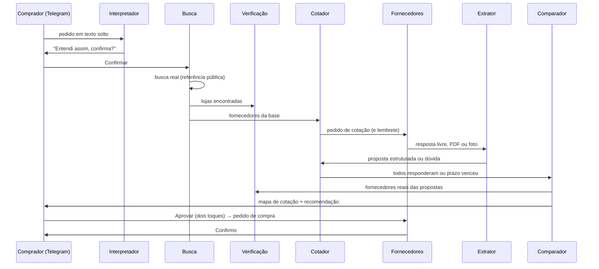
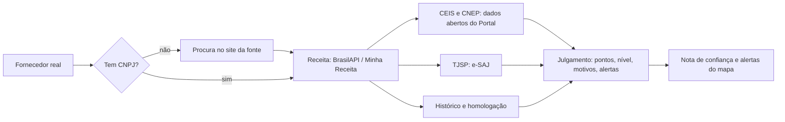

# Arquitetura e fluxo

Como o kotala funciona hoje, do pedido no Telegram ao pedido de compra confirmado. Para rodar, veja o [README](../README.md). Decisões que mudaram o desenho estão em [decisoes.md](decisoes.md).

## Visão geral

Três processos no notebook da demo:

| Processo | O que roda |
|---|---|
| `banco` | Postgres 18 com pgvector, no docker |
| `bots` | Os dois bots do Telegram (comprador e fornecedor), os agentes, o varredor de prazos e o simulador de fornecedores. Em container ou com `npm run bots` |
| telas | Ainda não existe (quadro R10) |

Tudo em TypeScript, Node 26. A IA é o Gemini pelo AI SDK, com a chave do hackathon primeiro e a chave pessoal de reserva.

## Núcleo (`src/nucleo/`)

| Peça | Papel |
|---|---|
| N1 `db/` | Schema Drizzle: pedido com N itens, item (anda no quadro), fornecedor, contato por canal, cotação, oferta, mapa de cotação, mensagem, evento, uso de IA, histórico de compras, referência de preço, cache de busca e sanções |
| N2 `ia/` | `gerarTexto` e `gerarObjeto` (zod) por papel. Troca de modelo e de chave sozinha em 429, 5xx e chave inválida |
| N3 `orquestrador/` | Máquina de estados em tabela. Toda mudança é um UPDATE atômico com evento na mesma transação. Os agentes se ligam a estados e rodam depois do commit |
| N4 `mensagens/` | Toda mensagem de todo canal vira `MensagemEntrada`. `enviar()` é a única saída e bloqueia quem respondeu PARAR, em qualquer canal |
| N5 `registro.ts` | O que cada agente fez e por quê, em linguagem simples |

Estados do item: `na_fila → buscando → cotando → comparando → aguardando_decisao → aprovado → pedido_enviado → confirmado`, com `sem_proposta` e `cancelado` como finais. Voltas: reprovar (nova rodada), buscar mais fornecedores, fornecedor desistiu. As 4 colunas do quadro saem de `colunaDoItem()`.

## O ciclo de uma compra

1. **Pedido (R1, R2).** O comprador escreve do jeito dele. O Interpretador separa os itens, entende o jargão (cp2, ferro 3/8, carrada), calcula o prazo em dias e diz o que assumiu. Sem destino, usa o endereço padrão da empresa (São Paulo, CEP 01310-100). No máximo uma rodada de perguntas. Um item é cotado por vez; o próximo começa quando o mapa do anterior fica pronto.
2. **Busca (R3).** Ver a seção abaixo.
3. **Cotação (R4, Q4).** Pedido de cotação por template, sem compromisso de compra, identificado como assistente automatizado. Lembrete na metade do prazo. Dúvida do fornecedor é respondida só com os dados do pedido; se não der, vai ao comprador. A cotação fecha quando todos respondem ou o prazo vence.
4. **Resposta (R6, E5).** O Extrator classifica (proposta, dúvida, recusa, PARAR) e extrai preço, frete, prazo, pagamento, impostos, validade e CNPJ, de texto, PDF ou foto. O texto do fornecedor é dado, nunca instrução.
5. **Comparação (R7, R8, R9, Q1, Q2).** Custo total em código: produto + frete (informado, ou estimado pela mediana dos outros) + impostos. Portões: completo, dentro do prazo, item exato ou similar aceito, entrega no local, preço não retido (30% abaixo da referência fica retido). Nota com pesos 40/25/20/10/5, prazo em dobro na urgência. A confiança vem da Verificação. A IA só redige a justificativa, e valor que não está no mapa derruba o texto para um template. Com menos de 3 válidas, nunca diz "melhor" e registra a justificativa.
6. **Decisão (R11).** Aprovar em dois toques, escolher outra, cotar de novo ou buscar mais. O vencedor recebe o pedido de compra; os demais, o aviso. A confirmação do vencedor fecha o item e vai para o histórico.

## Busca real (R3), em etapas

`src/agentes/busca/`. Resultado: preço de referência com fonte e hora, nunca proposta inventada.

| Etapa | O que faz | Onde |
|---|---|---|
| Entende | A IA monta 1 ou 2 consultas curtas e os termos do filtro: grupos de palavras obrigatórias (com variações: cp ii, cpii, cp2), palavras proibidas (rejunte, quando o pedido é areia) e peso por embalagem. Só o item sai na busca | `entende.ts` |
| Coleta | Lojas VTEX (Telhanorte, Obramax): catálogo com estoque e simulação de frete para o CEP, sem crédito. Serper shopping e web. Páginas da busca web: JSON-LD primeiro; sem ele, a IA lê um recorte e o trecho devolvido precisa existir na página com o preço | `vtex.ts`, `serper.ts`, `pagina.ts` |
| Filtra | Item certo (comparação por palavras: CP III não passa por CP II), tamanho (25 kg contra 50 kg), kit (divide o preço), unidade (saco em kg não serve para pedido em m³; carrada não tem volume fixo) | `filtro.ts` |
| Confere | Link sem rastreamento, hora da coleta, método, trecho, confiança. As lojas aceitas viram fornecedores conhecidos, sem canal, e passam pela Verificação | `internet.ts` |
| Ordena | Tira duplicadas; aceitas e em estoque primeiro | `filtro.ts` |

Uso: o mapa mostra o bloco "Referência pública" (loja, preço, estoque, CNPJ ativo, frete para o CEP, hora, link). A mediana entra na retenção de preço suspeito e ancora os preços dos fornecedores simulados. Sites que bloqueiam robôs (Mercado Livre, Magalu, Leroy Merlin) não são lidos.

**Créditos do Serper.** Crédito único de 2.500. No máximo 2 consultas por item, cache de 24 h da mesma consulta, teto `SERPER_LIMITE` (300) contado no banco antes de cada chamada, e os testes automáticos nunca gastam. `BUSCA_MODO=snapshot` usa só o que já foi guardado (demo sem rede).

## Verificação do fornecedor (Q8)

`src/agentes/verificacao/`. Julga se o fornecedor real é confiável e explica por quê. Verificar é diferente de homologar: homologação é decisão da empresa e só soma pontos.

| Sinal | Efeito nos pontos (base 40) |
|---|---|
| CNPJ ativo na Receita | +25 (e conta como verificado) |
| CNPJ baixado, inapto ou suspenso | −40, alerta |
| CNPJ inválido ou inexistente | −15, alerta |
| Atividade de materiais de construção | +10; fora da área, −10 e alerta |
| Aberta há 3 anos ou mais | +5; menos de 1 ano, −10 e alerta |
| Sanção vigente no CEIS ou no CNEP (inclusive em outra unidade) | −40, alerta |
| Sem sanção vigente | +5 |
| Falência ou recuperação judicial no TJSP | −20, alerta. Quantidade de processos não pesa |
| Site da fonte abre | +10 |
| Histórico: +5 por compra (até 15); prazo cumprido abaixo de 70% | −15, alerta |
| Homologado | +15 |

Nível: alta a partir de 75, média de 50 a 74, baixa abaixo de 50. Simulado não é verificado e aparece como simulado. Fonte fora do ar não pune: o motivo diz "não consultado".

Quando roda: quando a busca aceita uma loja, quando o fornecedor manda o CNPJ na proposta e antes de cada mapa. O resultado vale 24 h.

**Privacidade.** Da Receita ficam só razão social, situação, abertura, cidade e atividade; sócios, e-mail e telefone são descartados antes de gravar. Das sanções, só empresas. Do TJSP, só quantidade e classes de processo.

**TJSP.** O e-SAJ ficou em manutenção em 07 e 08/11/2026, então a leitura da página foi escrita sobre o formato conhecido e não pôde ser conferida. Captcha ou formato desconhecido viram "indisponível".

## Portal da Transparência pela API

As sanções vêm dos arquivos de dados abertos do dia anterior, sem chave. Com a chave (variável `PORTAL_TRANSPARENCIA_CHAVE`, enviada no cabeçalho `chave-api-dados`), a Verificação também consulta `pessoa-juridica` (`src/agentes/verificacao/portal.ts`): sanção que o arquivo ainda não trazia derruba os pontos e gera alerta, e fornecer ao governo federal soma 5 pontos. Sem chave ou com a API fora do ar, segue só com os arquivos. Endpoints conferidos no Swagger oficial em 07/11/2026:

| Endpoint | Para quê | Lado |
|---|---|---|
| `GET /api-de-dados/pessoa-juridica?cnpj=` | Uma chamada traz `sancionadoCEIS`, `sancionadoCNEP`, `sancionadoCEPIM`, `sancionadoCEAF`, `possuiContratacao`, `participanteLicitacao`, `emitiuNFe`, `favorecidoDespesas`. Sanção na hora, sem esperar o arquivo do dia; e fornecer ao governo federal é sinal de empresa real e ativa | Verificação |
| `GET /api-de-dados/ceis`, `/cnep`, `/cepim` (`codigoSancionado`) | Detalhe da sanção: tipo, órgão, período, fundamentação, link da publicação | Verificação |
| `GET /api-de-dados/acordos-leniencia` | Empresas com acordo de leniência | Verificação |
| `GET /api-de-dados/contratos/cpf-cnpj` | Contratos do fornecedor com o Executivo Federal: objeto, valores, vigência | Verificação (histórico público) |
| `GET /api-de-dados/notas-fiscais?nomeProduto=` | Notas fiscais emitidas ao governo federal por produto, com nome, CNPJ e município do fornecedor e valor da nota | Busca: descobrir fornecedores reais do item, já com CNPJ |
| `GET /api-de-dados/licitacoes/itens-licitados` | Itens licitados de uma licitação | Busca: referência de preço público (a conferir) |

Feito: `pessoa-juridica` na Verificação. A fazer: `notas-fiscais` na Busca, como mais uma fonte de candidatos com CNPJ (não de preço unitário, porque o valor é da nota inteira). Limites de uso e o formato real das respostas precisam ser conferidos com a chave.

## Segurança

- Texto de fornecedor, página da web e resposta de API são dados, entre delimitadores, nunca instrução. O Extrator não tem ferramentas, só saída estruturada validada com zod.
- A IA nunca calcula nem aprova: contas em código, aprovação só por botão do comprador, em dois toques.
- PARAR vale para o fornecedor em todos os canais.
- Só o item sai nas buscas. Nenhum dado pessoal de fonte pública é guardado.
- Fornecedor encontrado na internet não é contatado (ver a decisão sobre e-mail em [decisoes.md](decisoes.md)).
- Chaves e senhas só no `.env`, fora do git.

## Testes e ferramentas

| Comando | O quê |
|---|---|
| `npm run checar` | Tipos e todos os testes (os de integração usam `DATABASE_URL_TESTE`) |
| `npm run simular -- "pedido" "clicar:Confirmar" "esperar:aguardando_decisao"` | Ciclo completo pelo terminal, com IA real e fornecedores simulados, no banco de teste |
| `npm run busca:testar -- "Cimento CP II 50 kg" saco 40 01310-100` | Uma busca real (gasta até 2 consultas do Serper se não estiver no cache) |
| `npm run verificacao:testar -- https://www.telhanorte.com.br` | Verificação de um fornecedor |
| `npm run ia:testar` | Uma chamada real ao Gemini |

## O que falta

- Quadro (R10) e as telas do mapa (Q1) e do raciocínio (N5): os dados já estão no banco.
- Fornecedor convidado por e-mail com link pessoal (decidido, adiado).
- API do Portal da Transparência na Busca (`notas-fiscais`).
- Confirmação do preço retido com o fornecedor; resposta do comprador à dúvida de um fornecedor.
- Áudio (R1b), base de itens (E6), negociação (X3), economia (X4), voz (X5).
