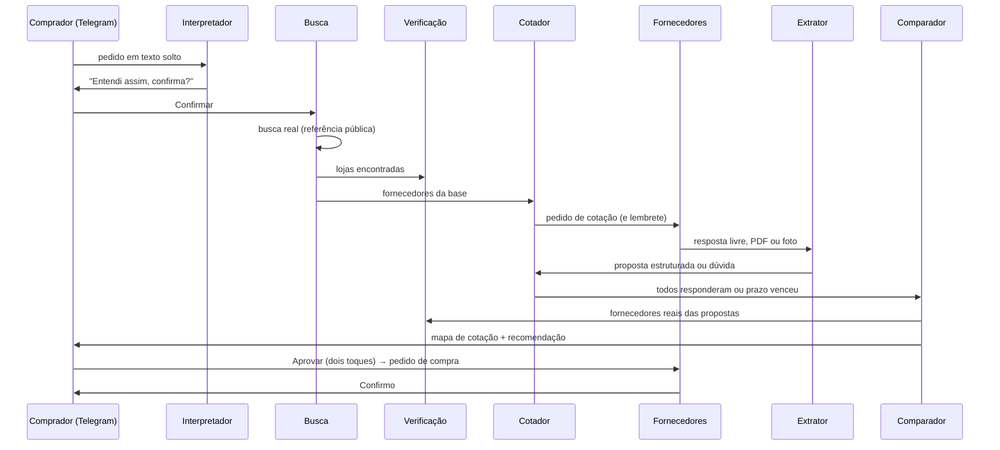
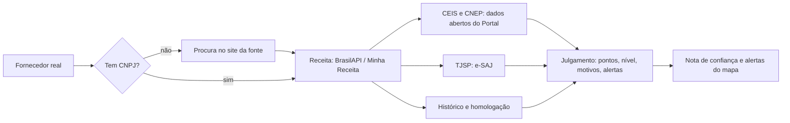
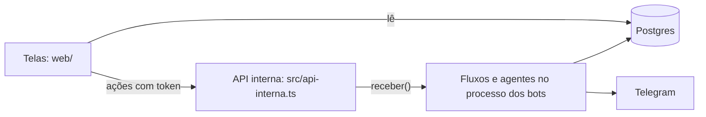

# Arquitetura e fluxo

Como o kotala funciona hoje, do pedido no Telegram ao pedido de compra confirmado. Para rodar, veja o [README](../README.md). Decisões que mudaram o desenho estão em [decisoes.md](decisoes.md).

## Visão geral

Três processos no notebook da demo:

| Processo | O que roda |
|---|---|
| `banco` | Postgres 18 com pgvector, no docker |
| `bots` | Os dois bots do Telegram (comprador e fornecedor), os agentes, o varredor de prazos e o simulador de fornecedores. Em container ou com `npm run bots` |
| telas | Ainda não existe (quadro R10) |

Tudo em TypeScript, Node 26. A IA é o Gemini pelo AI SDK, com a chave do hackathon primeiro e a chave pessoal de reserva.

## Núcleo (`src/nucleo/`)

| Peça | Papel |
|---|---|
| N1 `db/` | Schema Drizzle: pedido com N itens, item (anda no quadro), fornecedor, contato por canal, cotação, oferta, mapa de cotação, mensagem, evento, uso de IA, histórico de compras, referência de preço, cache de busca e sanções |
| N2 `ia/` | `gerarTexto` e `gerarObjeto` (zod) por papel. Troca de modelo e de chave sozinha em 429, 5xx e chave inválida |
| N3 `orquestrador/` | Máquina de estados em tabela. Toda mudança é um UPDATE atômico com evento na mesma transação. Os agentes se ligam a estados e rodam depois do commit |
| N4 `mensagens/` | Toda mensagem de todo canal vira `MensagemEntrada`. `enviar()` é a única saída e bloqueia quem respondeu PARAR, em qualquer canal |
| N5 `registro.ts` | O que cada agente fez e por quê, em linguagem simples |

Estados do item: `na_fila → buscando → cotando → comparando → aguardando_decisao → aprovado → pedido_enviado → confirmado`, com `sem_proposta` e `cancelado` como finais. Voltas: reprovar (nova rodada), buscar mais fornecedores, fornecedor desistiu. As 4 colunas do quadro saem de `colunaDoItem()`.

## O ciclo de uma compra



1. **Pedido (R1, R2).** O comprador escreve do jeito dele. O Interpretador separa os itens, entende o jargão (cp2, ferro 3/8, carrada), calcula o prazo em dias e diz o que assumiu. Sem destino, usa o endereço padrão da empresa (São Paulo, CEP 01310-100). No máximo uma rodada de perguntas. Um item é cotado por vez; o próximo começa quando o mapa do anterior fica pronto.
2. **Busca (R3).** Ver a seção abaixo.
3. **Cotação (R4, Q4).** Pedido de cotação por template, sem compromisso de compra, identificado como assistente automatizado. Lembrete na metade do prazo. Dúvida do fornecedor é respondida só com os dados do pedido; se não der, vai ao comprador. A cotação fecha quando todos respondem ou o prazo vence.
4. **Resposta (R6, E5).** O Extrator classifica (proposta, dúvida, recusa, PARAR) e extrai preço, frete, prazo, pagamento, impostos, validade e CNPJ, de texto, PDF ou foto. O texto do fornecedor é dado, nunca instrução.
5. **Comparação (R7, R8, R9, Q1, Q2).** Custo total em código: produto + frete (informado, ou estimado pela mediana dos outros) + impostos. Portões: completo, dentro do prazo, item exato ou similar aceito, entrega no local, preço não retido (30% abaixo da referência fica retido). Nota com pesos 40/25/20/10/5, prazo em dobro na urgência. A confiança vem da Verificação. A IA só redige a justificativa, e valor que não está no mapa derruba o texto para um template. Com menos de 3 válidas, nunca diz "melhor" e registra a justificativa.
6. **Decisão (R11).** Aprovar em dois toques, escolher outra, cotar de novo ou buscar mais. O vencedor recebe o pedido de compra; os demais, o aviso. A confirmação do vencedor fecha o item e vai para o histórico.

## Busca real (R3), em etapas

`src/agentes/busca/`. Resultado: preço de referência com fonte e hora, nunca proposta inventada.

| Etapa | O que faz | Onde |
|---|---|---|
| Entende | A IA monta 1 ou 2 consultas curtas e os termos do filtro: grupos de palavras obrigatórias (com variações: cp ii, cpii, cp2), palavras proibidas (rejunte, quando o pedido é areia) e peso por embalagem. Só o item sai na busca | `entende.ts` |
| Coleta | Lojas VTEX (Telhanorte, Obramax): catálogo com estoque e simulação de frete para o CEP, sem crédito. Serper shopping e web. Páginas da busca web: JSON-LD primeiro; sem ele, a IA lê um recorte e o trecho devolvido precisa existir na página com o preço | `vtex.ts`, `serper.ts`, `pagina.ts` |
| Filtra | Item certo (comparação por palavras: CP III não passa por CP II), tamanho (25 kg contra 50 kg), kit (divide o preço), unidade (saco em kg não serve para pedido em m³; carrada não tem volume fixo) | `filtro.ts` |
| Confere | Link sem rastreamento, hora da coleta, método, trecho, confiança. As lojas aceitas viram fornecedores conhecidos, sem canal, e passam pela Verificação | `internet.ts` |
| Ordena | Tira duplicadas; aceitas e em estoque primeiro | `filtro.ts` |

Uso: o mapa mostra o bloco "Referência pública" (loja, preço, estoque, CNPJ ativo, frete para o CEP, hora, link). A mediana entra na retenção de preço suspeito e ancora os preços dos fornecedores simulados. Sites que bloqueiam robôs (Mercado Livre, Magalu, Leroy Merlin) não são lidos.

**Créditos do Serper.** Crédito único de 2.500. No máximo 2 consultas por item, cache de 24 h da mesma consulta, teto `SERPER_LIMITE` (300) contado no banco antes de cada chamada, e os testes automáticos nunca gastam. `BUSCA_MODO=snapshot` usa só o que já foi guardado (demo sem rede).

## Verificação do fornecedor (Q8)

`src/agentes/verificacao/`. Julga se o fornecedor real é confiável e explica por quê. Verificar é diferente de homologar: homologação é decisão da empresa e só soma pontos.



| Sinal | Efeito nos pontos (base 40) |
|---|---|
| CNPJ ativo na Receita | +25 (e conta como verificado) |
| CNPJ baixado, inapto ou suspenso | −40, alerta |
| CNPJ inválido ou inexistente | −15, alerta |
| Atividade de materiais de construção | +10; fora da área, −10 e alerta |
| Aberta há 3 anos ou mais | +5; menos de 1 ano, −10 e alerta |
| Sanção vigente no CEIS ou no CNEP (inclusive em outra unidade) | −40, alerta |
| Sem sanção vigente | +5 |
| Falência ou recuperação judicial no TJSP | −20, alerta. Quantidade de processos não pesa |
| Site da fonte abre | +10 |
| Histórico: +5 por compra (até 15); prazo cumprido abaixo de 70% | −15, alerta |
| Homologado | +15 |

Nível: alta a partir de 75, média de 50 a 74, baixa abaixo de 50. Simulado não é verificado e aparece como simulado. Fonte fora do ar não pune: o motivo diz "não consultado".

Quando roda: quando a busca aceita uma loja, quando o fornecedor manda o CNPJ na proposta e antes de cada mapa. O resultado vale 24 h.

**Privacidade.** Da Receita ficam só razão social, situação, abertura, cidade e atividade; sócios, e-mail e telefone são descartados antes de gravar. Das sanções, só empresas. Do TJSP, só quantidade e classes de processo.

**TJSP.** O e-SAJ ficou em manutenção em 07 e 08/11/2026, então a leitura da página foi escrita sobre o formato conhecido e não pôde ser conferida. Captcha ou formato desconhecido viram "indisponível".

## Portal da Transparência pela API

As sanções vêm dos arquivos de dados abertos do dia anterior, sem chave. Com a chave (variável `PORTAL_TRANSPARENCIA_CHAVE`, enviada no cabeçalho `chave-api-dados`), a Verificação também consulta `pessoa-juridica` (`src/agentes/verificacao/portal.ts`): sanção que o arquivo ainda não trazia derruba os pontos e gera alerta, e fornecer ao governo federal soma 5 pontos. Sem chave ou com a API fora do ar, segue só com os arquivos. Endpoints conferidos no Swagger oficial em 07/11/2026:

| Endpoint | Para quê | Lado |
|---|---|---|
| `GET /api-de-dados/pessoa-juridica?cnpj=` | Uma chamada traz `sancionadoCEIS`, `sancionadoCNEP`, `sancionadoCEPIM`, `sancionadoCEAF`, `possuiContratacao`, `participanteLicitacao`, `emitiuNFe`, `favorecidoDespesas`. Sanção na hora, sem esperar o arquivo do dia; e fornecer ao governo federal é sinal de empresa real e ativa | Verificação |
| `GET /api-de-dados/ceis`, `/cnep`, `/cepim` (`codigoSancionado`) | Detalhe da sanção: tipo, órgão, período, fundamentação, link da publicação | Verificação |
| `GET /api-de-dados/acordos-leniencia` | Empresas com acordo de leniência | Verificação |
| `GET /api-de-dados/contratos/cpf-cnpj` | Contratos do fornecedor com o Executivo Federal: objeto, valores, vigência | Verificação (histórico público) |
| `GET /api-de-dados/notas-fiscais?nomeProduto=` | Notas fiscais emitidas ao governo federal por produto, com nome, CNPJ e município do fornecedor e valor da nota | Busca: descobrir fornecedores reais do item, já com CNPJ |
| `GET /api-de-dados/licitacoes/itens-licitados` | Itens licitados de uma licitação | Busca: referência de preço público (a conferir) |

Feito: `pessoa-juridica` na Verificação. A fazer: `notas-fiscais` na Busca, como mais uma fonte de candidatos com CNPJ (não de preço unitário, porque o valor é da nota inteira). Limites de uso e o formato real das respostas precisam ser conferidos com a chave.

## Rastreio: nada se perde

Dá para saber o valor exato de qualquer dado e o estado de qualquer pedido em qualquer instante, e quem mudou o quê e por quê.

| Camada | O que guarda | Onde |
|---|---|---|
| Auditoria por gatilho | Toda inserção, alteração e remoção em `pedido`, `item_pedido`, `cotacao`, `oferta`, `fornecedor`, `contato`, `referencia_preco`, `mapa_cotacao`, `historico_compra` e `arquivo`, com a linha antes e depois. Feita no próprio Postgres, na mesma transação, seja qual for o código que mudou | tabela `auditoria`, migração `0007` |
| Eventos dos agentes | Quem fez, o quê, por quê, de qual estado para qual. O `txid` liga o evento às linhas de auditoria que ele mudou | tabela `evento` |
| Chamadas de IA | Agente, modelo, chave principal ou reserva, tokens, tempo, erro, e o prompt e a resposta (cortados em 8.000 caracteres; anexos viram tipo, tamanho e hash; resposta fora do formato também fica) | tabela `uso_ia` |
| Mensagens | Toda mensagem que entra e sai, ligada ao pedido e ao item depois que o fluxo descobre a qual pertence | tabela `mensagem` |
| Arquivos | PDF, foto e áudio baixados ficam em disco pelo hash (`ARQUIVOS_DIR`, volume `arquivos` no docker). Se o id do Telegram expirar, o original continua | tabela `arquivo` |
| Respostas cruas de APIs | Busca, CNPJ, TJSP e Portal, como vieram | tabela `cache_busca` |

Consultas prontas em `src/nucleo/rastreio.ts`: `estadoEm(tabela, chave, instante)`, `historicoDaLinha`, `fotoDoPedido(pedido, instante)` e `linhaDoTempo(pedido)`, que junta eventos, mudanças de dados, chamadas de IA e mensagens em ordem. A tela N5 da Frente 1 mostra essa linha do tempo. Pelo terminal:

```bash
npm run rastro -- 12                    # linha do tempo do pedido 12
npm run rastro -- 12 --completo         # com prompt e resposta da IA e todos os campos
npm run rastro -- 12 --em "2026-11-07T13:05:00-03:00"   # estado exato naquele instante
```

O que não entra no rastro: o raciocínio interno do modelo (a tela mostra o motivo declarado por cada agente e os números do Comparador) e os bytes dos anexos dentro do `uso_ia` (estão na tabela `arquivo`).

## Negociação e reprovação com motivo (Frente 2)

**Reprovar com motivo (N6).** No mapa, "Reprovar" abre os motivos; cada um leva o item a um ponto diferente (`src/fluxo/decisao.ts`):

| Motivo | Caminho |
|---|---|
| Preço alto | Negociação (X3), nova rodada só com os alvos |
| Prazo longo | Volta à busca, rodada nova com todos os fornecedores |
| Não confio no fornecedor | Ele sai do mapa deste item (`item_pedido.excluidos`) e o mapa é refeito |
| Cotar de novo com todos | Nova rodada com quem respondeu |
| Desistir deste item | Item cancelado, nada é comprado |

**Negociação (X3).** `src/agentes/negociador/`. Regras em código:

- Alvos: as propostas válidas que não são a mais barata, das de maior nota, até 3. Com uma só proposta, pede melhora a ela.
- A contraproposta **nunca cita valor de outro fornecedor** (proposta é dado sensível; ver [decisoes.md](decisoes.md)). Pode citar só a referência pública da internet. Pede melhora no preço, no frete ou no prazo de entrega, oferece combinar a forma de pagamento e diz que, se o fornecedor não responder, a proposta continua valendo. Nunca inventa proposta nem concorrente.
- No máximo 3 rodadas. A IA não redige nem decide nada aqui: é template.
- O Comparador usa a proposta mais recente de cada fornecedor até a rodada atual, então quem não responde mantém a anterior. O mapa mostra "o produto baixou de R$ A para R$ B", e o painel de economia soma o que a negociação conseguiu na compra escolhida.

**Preço retido (R8).** Proposta 30% ou mais abaixo da referência fica retida. Depois de mandar o mapa, o Comparador pergunta ao fornecedor se o valor é esse mesmo (uma vez por proposta). "Sim" confirma, o item volta a `comparando` (evento `reavaliar`) e o mapa é refeito; "não" deixa a proposta fora.

Estados novos do item: `negociar` (aguardando_decisao → cotando) e `reavaliar` (aguardando_decisao → comparando).

## Base de itens (E6) e fornecedores da base

Base fictícia feita pela Ester, copiada para `src/dados/` (a pasta de trabalho dela não é alterada): 36 itens com código (`ITM-001`…), especificação técnica, unidade e categoria, e 12 fornecedores com as categorias que vendem.

- **Casamento** (`src/agentes/interpretador/base-itens.ts`), sem IA: família pelas palavras do nome, com sinônimos de obra (vergalhão = barra de aço, isopor = EPS, fio = cabo, cano = tubo), e termos decisivos (números e classes) que têm de bater com a especificação.
- **Uma correspondência:** o item ganha o código, o nome técnico e a especificação; a unidade do comprador continua. O código deixa a chave do item estável, o que também ajuda a recompra.
- **Várias:** a confirmação traz botões curtos só com o que diferencia ("50 mm", "25 mm", "100 mm, alta densidade"). "Confirmar assim" segue com o item genérico. Texto solto continua valendo.
- **Item novo** (`src/agentes/interpretador/catalogo.ts`): na confirmação do pedido, o item que não casou com a base é cadastrado no catálogo (`item_catalogo`) com código próprio (`ITM-1001` em diante), regra da área de compras. Nas próximas vezes, casa com ele e recebe o mesmo código. A base fictícia não é alterada.
- **Fornecedores da base** (`src/simulador/personas.ts`): entram como simulados ao lado das 6 personas, cada um cotando só itens das categorias dele. O preço segue a referência real da internet; sem referência, ele responde que não tem o item, em vez de inventar.

## Memória e recompra (X2)

`src/agentes/memoria/`. Compra repetida em menos de 3 meses quase não muda de preço (regra da área de compras): antes de buscar, o sistema procura no histórico uma compra confirmada do mesmo item nos últimos 90 dias, com fornecedor que ainda tem canal e sem atraso registrado.

- Achou: o item vai para `aguardando_recompra` e o comprador vê a última compra (fornecedor, data, preço, frete, prazo combinado e se foi cumprido, quantas vezes comprou) com "Repetir" ou "Cotar de novo". Repetir leva dois toques (confirmação no Telegram, modal na tela).
- Repetir: o pedido de compra vai direto ao fornecedor, citando o preço da última compra. Se ele não mantiver, o item volta à busca (`recompra_recusada`) e é cotado.
- Mesmo item: chave igual, ou os termos decisivos idênticos (CP II não é CP III, 50 kg não é 25 kg) e quase todas as outras palavras iguais.
- O histórico vem das compras confirmadas (`historico_compra`); fornecedor simulado aparece como simulado.

## Voz em tempo real (X5)

Quando um fornecedor não respondeu ao texto, a tela do pedido mostra "Ligar por voz" ao lado dele (`/voz/<cotação>`).

- O navegador conversa direto com o Gemini Live (`VOZ_MODELO`, padrão `gemini-3.8-live`) com uma chave temporária gerada no servidor (`/api/voz/token`); a chave de verdade nunca vai ao navegador.
- O agente (`src/agentes/voz/`) abre dizendo que é o assistente automatizado da empresa, pergunta preço, frete, prazo, pagamento, validade e entrega um por vez, repete os valores para o fornecedor confirmar e só então chama a ferramenta `registrar_cotacao`. Nunca fecha compra nem cita valor de outro fornecedor.
- A ferramenta vai para o processo dos bots (`/api/voz/cotacao` → API interna `/voz/cotacao`): os valores são conferidos em código, a proposta entra no mapa com formato "voz" e a transcrição fica no registro. "Não atendo" e "não me ligue mais" também são registrados.
- A proposta por voz tem a mesma forma da de texto (`oferta.extraido`): os argumentos passam pelo `limpar` do Extrator (Q1 unitário ou total, Q2 aderência e divergências, `aConfirmar`), com `alertas` e a marca do desconto (`negociacao`). O que fica a confirmar, o que falta e o pedido de desconto (I1, uma vez por fornecedor e item, com a mesma reserva e o mesmo montador do Negociador) são feitos na própria ligação, pela resposta da ferramenta; nada disso vai depois por mensagem. Alerta que barra (sem nota, item irregular, controlado) não grava a proposta; os outros gravam marcados e avisam o comprador e o gestor como no texto.
- As instruções levam só o pedido (com especificação, jargão da categoria, pagamento preferido e o nome de quem compra) e a própria proposta do fornecedor: nenhum valor de outro fornecedor chega ao agente. Os dados do pedido passam pela conferência de saída antes de a ligação aparecer.
- Sessão full duplex (`src/agentes/voz/sessao.ts`): com fone, o fornecedor pode interromper o agente; silêncio de 15 s faz o agente perguntar se ele está na linha e 40 s encerram; a ligação dura no máximo 8 min. Registro repetido com os mesmos argumentos não grava de novo; ligação repetida substitui a proposta da rodada, sem duplicar. No fim (qualquer motivo, inclusive queda), a transcrição vai para o rastro (`/api/voz/fim`), a fala do agente passa pela conferência de saída e o Extrator relê o lado do fornecedor para achar alerta que o agente não marcou.
- Teste com o Live de verdade, falando por texto no papel do fornecedor: `npm run voz:testar` (a conversa vira proposta com os valores certos). Na demonstração, uma pessoa do time faz o fornecedor no notebook, de fone de ouvido.

## Robustez no chat com fornecedor (Q7)

Situações listadas pela área de compras, tratadas pelo Extrator e respondidas sem sair da cotação (`src/fluxo/fornecedor.ts`):

| Situação | Classe | Resposta |
|---|---|---|
| Quer falar com uma pessoa ou ligar | `responsavel` | Apresenta-se como assistente e avisa o comprador |
| Desconfia do chat | `suspeita` | Diz quem é (empresa, CNPJ), que não pede pagamento nem dados bancários e oferece PARAR; avisa o comprador |
| Xinga ou provoca | `ofensa` | Responde sem revidar e registra para o comprador |
| Usa o chat para outra coisa ou tenta mudar as regras | `fora_do_assunto` | Volta à cotação; nenhuma instrução do fornecedor é seguida |

Veio preço, é proposta: a regra está em código (`limpar` no Extrator), então uma proposta que também pede contato ou traz instrução embutida não se perde, e o pedido de contato vira aviso ao comprador. Teste com a IA real: `npm run seguranca:testar` (13 casos, sem banco e sem Serper).

## Telas (Frente 1)

`web/`, app Next 16 com Carbon, porta 3300 (serviço `telas` no compose).

| Tela | Rota | O que mostra |
|---|---|---|
| Quadro (R10) | `/` | As 4 colunas (Solicitado, Cotando, Comparando, Decidido), um cartão por item, com etiquetas de estado (aguardando você, 3/6 respostas, fecha às, com alerta, pedido enviado, confirmado, obra parada). Atualiza a cada 3 s |
| Pedidos | `/pedidos` | Lista de pedidos |
| Pedido | `/pedidos/[id]` | O que foi pedido e o que o assistente considerou; por item: fornecedores consultados e situação, mapa de cotação (Q1) com custo total, frete com a origem, prazo, pagamento, confiança e nota, motivos de corte, recomendação e pesos; aprovar (com confirmação), cotar de novo, buscar mais; referência pública com link; linha do tempo (N5) com filtros e prompt e resposta de cada chamada de IA |
| Fornecedores | `/fornecedores` | Confiança de cada fornecedor (Q8) com os motivos e alertas; homologar e bloquear (lista de bloqueio, com motivo obrigatório): bloqueado não entra em busca nem recompra |
| Dashboard (X4) | `/dashboard` | Desenho da Ester (`docs/workspaces/ester-workspace/interface-dashboard.md`): KPIs (pedidos emitidos, total gasto, saving em R$ e %, pedidos em atraso); pizza saving × gasto sobre o valor antes da negociação; curva normal da % de saving por pedido com o histograma atrás; custo por setor; status das requisições com o atraso em vermelho; tabela por pedido (média do mapa × compra). Filtros de período, setor e status; clique em fatia ou barra filtra. `/economia` redireciona para cá |
| Conversar (E3) | `/chat` | Chat web com o mesmo assistente do Telegram |
| Convite (Q5) | `/convite` | QR para a banca virar fornecedor pelo celular (link do bot do fornecedor, perguntado ao Telegram no servidor) |

Como as telas conversam com o resto:



- As telas não rodam agente nenhum: os agentes ficam num processo só. A ação da tela entra pela mesma `receber()` do Telegram, como se o comprador dono do pedido tivesse tocado no botão, e por isso aparece no rastro e avisa o comprador no canal dele.
- A aprovação pela tela também tem dois toques (botão e confirmação no modal).
- API interna: `POST /acoes/botao` (botão de um pedido) e `POST /chat` (mensagem do chat web), cabeçalho `x-kotala-token`. No docker fica aberta só na rede interna e publicada em `127.0.0.1:3301`.
- O canal `web` (`src/canais/web.ts`) não empurra nada: a saída já fica na tabela `mensagem`, e o chat consulta a cada 1,5 s.

## Áudio, foto e print do comprador (R1b)

O comprador pode mandar áudio, foto do material, print de anúncio (Mercado Livre, Leroy...) ou PDF, com ou sem legenda. `src/agentes/interpretador/anexos.ts` transforma o anexo em texto de pedido antes do Interpretador, e o resto do fluxo (confirmação, correção, reinterpretação) segue só com texto.

- **Áudio:** vira a transcrição, como se tivesse sido escrita. "Sim, pode cotar" falado confirma o pedido.
- **Foto, lista e print:** viram uma descrição com a origem marcada (`[Foto]`, `[Lista]`, `[Print de loja]`). Do print saem também título, loja, vendedor, preço e unidade: o comprador recebe "No print: ... R$ 42,90 por saco (Mercado Livre, ...). Anotei no pedido." e a leitura fica no rastro do pedido (evento do Interpretador com `dados.leitura`). Por enquanto o preço do print não entra no mapa de cotação; isso fica para depois da junção.
- **Rastreio:** o original é guardado com hash pelo `baixarAnexo` e a chamada de IA fica no `uso_ia`.
- **Fornecedor:** áudio vai direto para o Extrator, junto com PDF e foto (formato `voz` na oferta).
- **Teste ao vivo:** `npm run anexo:testar -- arquivo.ogg|.png|.pdf ["legenda"]` mostra a leitura e o texto que entraria no pedido, sem bot nem banco.

## Convite do fornecedor por e-mail (E1)

O fornecedor não se cadastra: recebe um e-mail com um link pessoal do bot (`t.me/<bot_fornecedor>?start=<código>`). Ao abrir, o bot liga a conversa ao fornecedor já conhecido, sem perguntar o nome, e reenvia no Telegram a cotação que ele ainda deve. O link genérico com pergunta do nome (`?start=cadastro`) continua como reserva para o QR do pitch.

- **Trava:** o canal `email` (`src/canais/email.ts`) só envia para endereços em `EMAIL_PERMITIDOS` ou digitados num convite manual (fornecedor com fonte "Convite manual por e-mail"). Qualquer outro envio falha e fica gravado em `mensagem` com o motivo. A busca ainda não guarda e-mail de loja, então nenhum fornecedor real é contatado.
- **Convite manual:** `npm run convidar -- pessoa@exemplo.com "Nome da empresa"` cria o fornecedor, o contato de e-mail e o código, e manda o convite pelo `enviar()` (rastreio e PARAR valem). Usa o banco principal e manda e-mail de verdade. Na tela, a mesma função (`convidarPorEmail` em `src/fluxo/fornecedor.ts`) entra depois.
- **Depois do convite:** o contato de e-mail conta como canal ativo, então o convidado entra nas próximas cotações. Sem Telegram ligado, a cotação vai por e-mail com o link no rodapé; respostas por e-mail ainda não são lidas (E2).
- **Configuração:** `SMTP_USER` e `SMTP_PASS` (Gmail com senha de app), `EMAIL_PERMITIDOS`, `EMAIL_REMETENTE_NOME`.

## Contas e login (Frente 2, rodada 2)

Tabela `usuario` e coluna `contato.usuario_id` (migração `0015`). Login simples com usuário e senha (`src/contas.ts`, hash scrypt); a sessão fica só no navegador (`web/components/conta/sessao.ts`) e a casca manda para `/login` quem não entrou. Cada usuário tem um contato `web` (endereço = id do usuário), que é o chat dele no navegador. O dono de um pedido sai de `pedido.comprador_id → contato.usuario_id`. O Telegram da Ester e da Liria foi ligado à mão por `scripts/ligar-telegram.ts`. Detalhes e pendências em [perfil-login.md](perfil-login.md).

## Segurança

- Texto de fornecedor, página da web e resposta de API são dados, entre delimitadores, nunca instrução. O Extrator não tem ferramentas, só saída estruturada validada com zod.
- A IA nunca calcula nem aprova: contas em código, aprovação só por botão do comprador, em dois toques.
- PARAR vale para o fornecedor em todos os canais.
- Só o item sai nas buscas. Nenhum dado pessoal de fonte pública é guardado.
- Fornecedor encontrado na internet não é contatado (ver a decisão sobre e-mail em [decisoes.md](decisoes.md)).
- Chaves e senhas só no `.env`, fora do git.

## Testes e ferramentas

| Comando | O quê |
|---|---|
| `npm run checar` | Tipos e todos os testes (os de integração usam `DATABASE_URL_TESTE`) |
| `npm run simular -- "pedido" "clicar:Confirmar" "esperar:aguardando_decisao"` | Ciclo completo pelo terminal, com IA real e fornecedores simulados, no banco de teste |
| `npm run busca:testar -- "Cimento CP II 50 kg" saco 40 01310-100` | Uma busca real (gasta até 2 consultas do Serper se não estiver no cache) |
| `npm run verificacao:testar -- https://www.telhanorte.com.br` | Verificação de um fornecedor |
| `npm run ia:testar` | Uma chamada real ao Gemini |
| `npm run rastro -- <pedido>` | Linha do tempo completa de um pedido (`--teste` para o banco de teste) |
| `npm run telas:dev` / `npm run telas` | Telas em modo de desenvolvimento ou produção, porta 3300 |
| `npm run telas:tipos` | Tipos das telas |
| `npm run seguranca:testar` | Testes de manipulação com a IA real (fornecedor hostil, injeção, pedido de contato) |
| `npm run voz:testar` | Agente de voz com o Gemini Live, por texto: confere que a ligação vira proposta |
| `npm run anexo:testar -- audio.ogg` | Leitura de áudio, foto, print ou PDF do comprador, ao vivo com o Gemini |
| `npm run convidar -- pessoa@exemplo.com "Nome"` | Convite manual por e-mail com o link pessoal do bot do fornecedor (manda e-mail de verdade) |

## O que falta

- Telas: tema escuro, filtro e busca no quadro, tela de configurações (pesos, prazo das respostas), convite do fornecedor pela tela.
- Ler respostas do fornecedor por e-mail (E2); guardar o e-mail das lojas achadas na busca.
- API do Portal da Transparência na Busca (`notas-fiscais`).
- Entregas parciais.
- Preço do print do comprador no mapa de cotação. Escolha da variação da base também pela tela (hoje no Telegram e no chat).
- Voz: ligação pelo celular (exige HTTPS, por exemplo um túnel) e ligação telefônica de verdade.
- Memória: contrato anual com pedido automático.

## Assistente do chat web (Frente 3)

`src/assistente/`. No chat web, texto livre passa antes por um agente com ferramentas de leitura: ele responde o que está pendente, como está cada pedido, por que uma proposta ficou de fora, quanto se economizou, quem vende cada categoria. Ele cita pedidos e telas com links e oferece botões de ação. Pedido novo, correção, confirmação e resposta a dúvida de fornecedor seguem para o fluxo de pedidos, sem mudança. Botão, anexo e "sim" com pedido em confirmação vão direto ao fluxo.

- **A IA nunca age.** Ação é botão com o mesmo `dado` do fluxo, e aprovar continua em dois toques. Botão de ação só em pedido da própria conversa; para os outros, o link da tela.
- **Conferência em código.** Valor em R$, número de pedido e link precisam ter vindo das ferramentas ou do histórico. Senão, o modelo forte tenta de novo, e depois disso a resposta cai num texto seguro com os links.
- **Modelos.** Papel `conversa` (`gemini-3.5-flash-lite`) e `conversa_forte` (`gemini-3.8-flash`), com a mesma cadeia de reserva e o mesmo registro em `uso_ia`. `ASSISTENTE=desligado` volta ao fluxo puro.
- **Links.** Botão com `dado` `link:/rota` (só o chat web entende) e links Markdown relativos, sempre de uma lista fechada de rotas.
- **Telegram.** Ainda não passa pelo Assistente. Anotações em [frente-3-harness.md](frente-3-harness.md#telegram-anotações-para-depois).

Desenho, avaliação de modelos e furos achados: [frente-3-harness.md](frente-3-harness.md). Avaliação: `npm run assistente:avaliar`.
