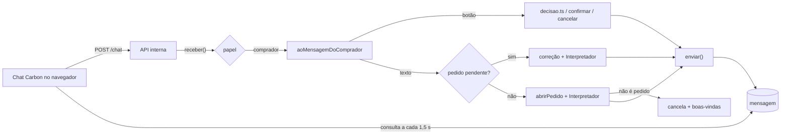
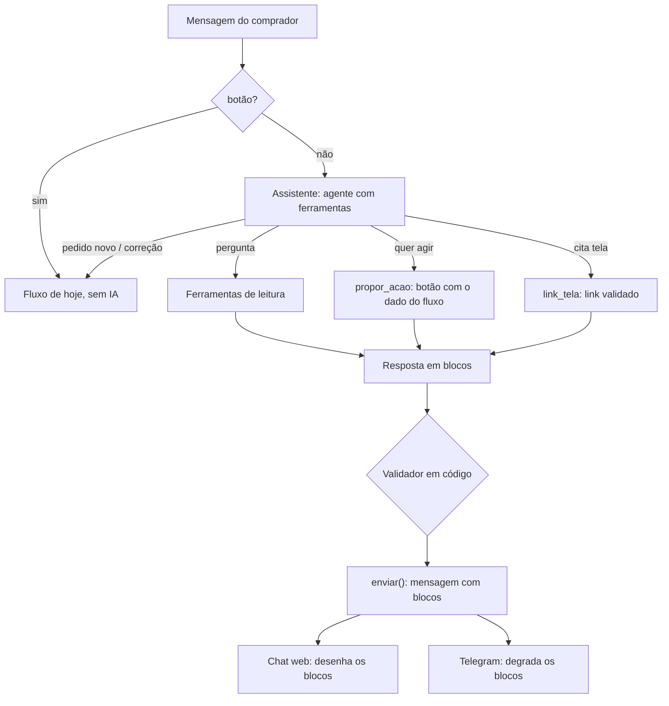

# Frente 3 · Harness do assistente e modelos (investigação)

Investigação de 08/11/2026 sobre como transformar o chat do comprador num assistente que sabe tudo da operação: o que está pendente, cada pedido, cada mapa. Ele também deve responder com botões e links para a própria interface e escolher o modelo certo para cada mensagem. Primeiro o chat web; no fim, o que dá para levar ao Telegram.

Nada foi implementado. Este documento é a base para decidir o desenho e dividir o trabalho. Leia junto com [arquitetura.md](arquitetura.md) e [frentes.md](frentes.md).

## Resumo

1. **Hoje o chat não conversa.** Toda mensagem livre vira pedido novo ou correção do pedido aberto. "O que está pendente?" abre um pedido, o Interpretador conclui que não é pedido, o pedido é cancelado e volta o texto de boas-vindas. Com um pedido esperando confirmação, a pergunta vira uma "correção" que não é entendida.
2. **Proposta:** uma camada nova, o Assistente, na frente do fluxo atual e não no lugar dele.
   - Botões continuam determinísticos, sem IA.
   - Texto livre passa por um agente com ferramentas. Pedido novo e correção são entregues ao fluxo de hoje, sem mudança. Pergunta é respondida com dados do banco. Ação vira botão com o mesmo `dado` que o fluxo já entende, então os dois toques continuam valendo.
3. **Respostas ricas:** a mensagem passa a carregar blocos (texto, botão de ação, link para tela, cartão de pedido). O chat da Carbon já desenha botões de URL, cartões, cartão de prévia com painel lateral e passos de raciocínio, e não usamos nada disso.
4. **Modelos:** `gemini-3.5-flash-lite` como padrão do chat, escalando para `gemini-3.8-flash` em pergunta difícil. O `gemini-4-argon` funciona com a chave, mas levou 11 s de mediana por passo: serve como juiz na avaliação, não para o chat. Ver [Modelos](#modelos-e-roteamento).
5. **Telegram:** com qualidade total, só via Mini App, que exige endereço HTTPS público. Com qualidade parcial, por mensagens: texto formatado, botões de ação e streaming do rascunho.
6. **Avaliação:** o harness de teste previsto em `frentes.md` continua necessário. Ele é o que diz se o assistente melhorou ou piorou e se um modelo novo vale a troca.

## Escopo: o pedido muda a Frente 3

Em [frentes.md](frentes.md), a Frente 3 é um **harness de teste**: um comprador simulado que opera tudo e relata o que quebrou, mais a comparação de modelos. O pedido de agora é um **harness de agente** para o chat de verdade. Isso esbarra em pastas de outras frentes:

| Peça | Dono hoje em `frentes.md` | O que o Assistente precisa |
|---|---|---|
| `web/components/chat/`, `src/canais/web.ts` | Frente 2 (chat por usuário) | Desenhar blocos (cartões, links, botões de URL) |
| `src/fluxo/comprador.ts`, `src/agentes/` | Frente 4 | Um ponto de entrada para o Assistente decidir antes do fluxo |
| `src/nucleo/mensagens/` (tipo `Botao`) | Ninguém muda comportamento | Botão com `href` além de `dado` (acréscimo) |
| `src/nucleo/db/schema.ts` | Só a Frente 2 gera migração | Coluna de blocos na `mensagem`; talvez histórico de passos do agente |
| `src/nucleo/ia/config.ts` | Frente 3 | Papel novo `conversa` e a cadeia de modelos dele |

Sugestão de divisão, a decidir:

- **A Frente 3 fica com o Assistente inteiro:** `src/assistente/` (pasta nova), o papel `conversa`, as ferramentas e a avaliação.
- **A Frente 4 recebe só o gancho:** o fluxo do comprador chama o Assistente antes de abrir pedido.
- **A Frente 2 recebe só a migração:** a coluna de blocos.
- **O desenho dos blocos no chat** pode ficar com a Frente 3, já que o chat é pequeno e a Frente 2 mexe nele só para separar por usuário. Se for assim, as duas frentes precisam combinar a fronteira em "Pedidos entre frentes".

## Como é hoje

### O caminho de uma mensagem do chat web



### O que já existe e serve

| Peça | Onde | Uso no Assistente |
|---|---|---|
| Cadeia de reserva com disjuntor (429, 5xx, chave) e registro em `uso_ia` | `src/nucleo/ia/` | Mesmo mecanismo, aplicado ao modelo do agente |
| Botões com `dado` (`pedido:12:confirmar`, `item:34:aprovar:<oferta>`...) | `fluxo/comprador.ts`, `fluxo/decisao.ts` | Ações do Assistente viram estes botões |
| Avisos (o que espera o comprador) | `web/lib/avisos.ts` | Ferramenta `listar_pendencias` |
| Pedidos, detalhe, mapa, economia, fornecedores | `web/lib/dados*.ts` | Ferramentas de leitura |
| Linha do tempo com eventos, mudanças e chamadas de IA | `src/nucleo/rastreio.ts` | "O que aconteceu com o pedido 12?" |
| Último mapa e cálculo | `agentes/comparador/` | Explicar nota, corte e recomendação |
| Recompra e histórico | `agentes/memoria/` | "Quanto paguei da última vez?" |
| Agente com ferramenta (Gemini Live) | `agentes/voz/` | Exemplo de ferramenta conferida em código |

### O que falta

- Nenhuma chamada de IA usa ferramentas no texto. `gerarTexto` e `gerarObjeto` são uma chamada só.
- `Botao` é só `{ rotulo, dado }`: não há link nem cartão.
- O chat desenha texto em Markdown e uma fileira de botões. A Carbon (`@carbon/ai-chat` 1.24) suporta mais coisas:
  - `button` com tipo `url` ou `custom_event`;
  - `card`, `carousel`, `grid` e `preview_card`, que abre um painel lateral ("workspace");
  - `chain_of_thought`, que mostra os passos;
  - `conversational_search`, com citações;
  - streaming por `addMessageChunk`.
- Sem streaming: a API interna só responde depois que o fluxo termina, e o chat consulta o banco a cada 1,5 s.
- As consultas de `web/lib/` são de todos os compradores. O filtro por comprador vem com a Frente 2.

### Problemas achados no caminho (para "Pedidos entre frentes", Frente 4)

- **Pergunta vira pedido cancelado.** Cada pergunta cria uma linha em `pedido` com estado `cancelado` e motivo "A mensagem não tinha pedido de material". O quadro esconde as canceladas, mas elas entram nas contagens e no rastro.
- **Pergunta vira correção.** Dentro da janela de 1 h de um pedido em "confirma?", qualquer texto que não seja confirmação nem saudação vira correção. "Quanto tá o cimento?" vira "Não entendi essa correção".

## Arquitetura proposta



### Princípios (os mesmos de [arquitetura.md](arquitetura.md#segurança))

- **A IA nunca age sozinha.** Não existe ferramenta `aprovar`. A ferramenta `propor_acao` só gera o botão que o fluxo de hoje já entende. Tocar no botão leva à confirmação, então os dois toques continuam iguais.
- **Quem é o comprador vem do contexto, nunca do modelo.** O `contatoId` entra pelo `toolsContext` do AI SDK. A ferramenta recebe `pedidoId` do modelo e confere no banco se o pedido é desse comprador antes de responder.
- **Números vêm das ferramentas.** O validador confere que todo valor em R$, todo número de pedido e todo link da resposta apareceram em algum resultado de ferramenta deste turno. Se não apareceram, troca o texto por um template, como o Comparador já faz.
- **Texto de fornecedor é dado.** O resultado de uma ferramenta que traga uma mensagem de fornecedor vai entre delimitadores, como no Extrator.
- **O fluxo de hoje não muda.** Pedido novo e correção seguem por `abrirPedido` e `interpretarEResponder`. O Assistente decide para onde a mensagem vai, mas não reescreve o Interpretador.

### Onde roda

No processo dos bots, como os outros agentes. Um gancho no começo de `aoMensagemDoComprador` (texto, sem botão) chama `responderComoAssistente()`. Se ele devolve "é pedido" ou "é correção", o fluxo segue como hoje; se não, o Assistente já respondeu. Assim o Telegram e o chat web ganham o Assistente juntos, e o rastro fica no mesmo lugar.

### Contexto de cada turno

| Camada | O quê | Custo |
|---|---|---|
| Instruções fixas | Quem é, regras, como citar telas, o que nunca fazer | ~1.000 tokens, iguais em todo turno (o cache implícito do Gemini ajuda a partir de 4.096 tokens no total) |
| Cartão de estado | Gerado em código a cada turno: pendências, pedidos abertos (id, nome legível, estado de cada item) e o pedido em "confirma?", se houver | ~300 a 800 tokens; responde sozinho a maioria das perguntas simples, sem chamar ferramenta |
| Histórico | Últimas N mensagens da tabela `mensagem` desta conversa, só texto | Corta por tamanho |
| Ferramentas | Esquemas das ferramentas ativas no passo | ~1.000 tokens com 10 ferramentas |

**Histórico e thought signatures.** Os modelos Gemini 3 devolvem uma assinatura em cada chamada de ferramenta. Remontar a conversa com essas chamadas sem a assinatura dá erro 400 (relatos da comunidade; a doc oficial atual fala disso só para a Interactions API). Começo recomendado:
- Os passos de ferramenta vivem só dentro do turno, onde o AI SDK mantém as mensagens intactas.
- Entre turnos vai só o texto e o cartão de estado.
- Guardar os passos entre turnos exigiria tabela nova (Frente 2) e só vale se a avaliação mostrar que falta memória.

## Ferramentas

O Google recomenda de 10 a 20 ferramentas ativas no máximo ([function calling](https://aistudio.google.com/docs/function-calling)). Com `activeTools` no `prepareStep`, cada passo liga só o grupo que faz sentido.

| Ferramenta | Grupo | De onde vem o dado | Observação |
|---|---|---|---|
| `listar_pendencias` | leitura | `web/lib/avisos.ts` (`listarAvisos`) | Já ordena por urgência; filtrar pelo comprador |
| `buscar_pedidos(texto?, estado?)` | leitura | `web/lib/dados-operacao.ts` (`pedidosOperacao`) | Busca por item, setor, fornecedor |
| `detalhe_pedido(pedidoId)` | leitura | `web/lib/dados-pedido.ts`, `dados.ts` (`detalhePedido`) | Itens, estados, fornecedores consultados, prazos |
| `mapa_cotacao(itemId)` | leitura | `agentes/comparador` (`ultimoMapa`) | Propostas, custo total, nota, cortes, recomendação |
| `linha_do_tempo(pedidoId)` | leitura | `nucleo/rastreio.ts` (`linhaDoTempo`) | "Por que demorou?", "quem mudou isso?" |
| `fornecedor(id ou nome)` | leitura | `web/lib/dados-consulta.ts` (`fichaFornecedor`) | Confiança, motivos, alertas, homologação |
| `historico_compras(item)` | leitura | `agentes/memoria` | Última compra, preço, prazo cumprido |
| `economia(periodo?)` | leitura | `web/lib/dados.ts` (`economia`) e o dashboard | Sempre dizendo contra o que compara |
| `regras_de_compra(tema)` | leitura | `src/config.ts` e `docs/decisoes.md` | Pesos da nota, prazos, retenção de preço |
| `registrar_pedido(texto)` | encaminhamento | `abrirPedido` + `interpretarEResponder` | O Interpretador continua dono da leitura |
| `corrigir_pedido(pedidoId, texto)` | encaminhamento | caminho da correção em `comprador.ts` | Só para pedido em "confirma?" |
| `responder_fornecedor(texto)` | encaminhamento | `repassarRespostaDoComprador` | Quando há dúvida de fornecedor esperando |
| `propor_acao(acao, ids)` | ação | gera `Botao` com o `dado` de `comprador.ts` / `decisao.ts` | Valida estado e dono antes; nada acontece sem toque |
| `link_tela(rota, ids)` | navegação | lista fechada de rotas de `web/app/` | `/pedidos/12/decisao#item-34`, `/fornecedores/<id>`, `/avisos`... |

As consultas de `web/lib/` são Drizzle puro e já importam de `src/`. O caminho limpo é mover as que o Assistente usa para `src/consultas/`, com o filtro por comprador, e fazer `web/lib/` importar de lá. Como isso mexe em arquivos da Frente 1 e da Frente 2, só deve ser feito depois da junção delas.

### "Skills"

O `HarnessAgent` do AI SDK 7 ("AI SDK Harnesses") roda agentes prontos, como Claude Code, Codex e Pi, dentro de uma sandbox. Ele serve para agentes de código e **não** se encaixa aqui. O que funciona como "skill" neste projeto é um **guia por situação**: um trecho de instruções, mais o grupo de ferramentas, carregado quando o assunto aparece.

| Guia | Quando entra | Ferramentas que liga |
|---|---|---|
| Pedido novo | O comprador quer comprar algo | `registrar_pedido`, `historico_compras` |
| Decisão | Há mapa esperando ou ele pergunta de proposta | `mapa_cotacao`, `fornecedor`, `propor_acao` |
| Acompanhamento | "Como está", "por que demorou" | `buscar_pedidos`, `detalhe_pedido`, `linha_do_tempo` |
| Fornecedores | Confiança, bloqueio, homologação | `fornecedor`, `link_tela` |
| Regras e economia | "Como a nota é calculada", "quanto economizei" | `regras_de_compra`, `economia` |

Dá para escolher o guia de duas formas:
- **Em código, por palavras e pelo cartão de estado.** Sem custo e previsível. É por onde começar.
- **Pelo próprio modelo**, com uma ferramenta `carregar_guia(tema)` no primeiro passo. Custa um passo a mais.

## Respostas ricas: blocos

A mensagem de saída ganha uma lista de blocos, guardada numa coluna `blocos jsonb` da `mensagem`. Isso exige migração, da Frente 2. O `texto` continua existindo como versão simples, para o Telegram e para o rastro.

| Bloco | Chat web (Carbon) | Telegram |
|---|---|---|
| `texto` (Markdown) | `text` | HTML (`<b>`, `<a>`, `<blockquote expandable>`) |
| `acao` `{ rotulo, dado, estilo? }` | `button` `post_back` (ou o botão de hoje) | Botão inline `callback_data` (até 64 bytes; `item:34:aprovar:<uuid>` tem ~55) com `style` `success`/`danger` |
| `link` `{ rotulo, rota }` | `button` tipo `custom_event` → `router.push`, sem recarregar | Botão `url` (exige endereço público) ou `web_app` (Mini App) |
| `cartao_pedido` | `card` ou `preview_card` que abre o pedido no painel lateral | Texto curto + botões |
| `pendencias` | `carousel` ou lista de cartões | Lista numerada + um botão por item |
| `passos` | `chain_of_thought` ("consultei o mapa do item 34") | Omitido |

**Validação dos links.** A rota tem de estar na lista fechada e os ids têm de ser do comprador. Link Markdown no meio do texto passa pelo mesmo filtro: link para rota desconhecida vira texto simples.

**Mudança pequena no núcleo.** Hoje `Botao` é `{ rotulo, dado }`. Basta acrescentar `href?` e `estilo?`, sem mudar o comportamento de ninguém, e o adaptador do Telegram passa a entender `href`.

## Modelos e roteamento

### O que a chave enxerga e quanto custa

Preços da [página oficial](https://aistudio.google.com/docs/pricing), em 08/11/2026, em US$ por milhão de tokens:

| Modelo | Situação | Entrada / saída | Nível gratuito | Observação |
|---|---|---|---|---|
| `gemini-3.1-flash-lite` | estável | 0,25 / 1,50 | sim | O mais barato |
| `gemini-3.5-flash-lite` | estável | 0,30 / 2,50 | sim | Papel "rápido" de hoje |
| `gemini-3.8-flash` | estável | 0,75 / 3,75 (dobra em 2027) | sim | Papel "forte" de hoje; o Google o indica para agentes |
| `gemini-3.1-pro-preview` | preview | 2 / 12 | não | |
| `gemini-4-argon` | estável | 2 / 10 até 30/11, **4 / 20 a partir de 01/12** | não | Ignora temperatura; pede saída máxima ≥ 32k e timeout longo |

Os limites por minuto e por dia não estão publicados: só aparecem no AI Studio da conta. **Falta conferir os limites da chave do hackathon** antes de pôr qualquer modelo pro ou argon no caminho do chat. No nível gratuito, o Google usa o conteúdo enviado para melhorar os produtos dele; vale saber em que nível está a chave, porque as conversas têm dados de fornecedores e preços.

### Benchmark de roteamento (08/11/2026)

Teste feito fora do repositório, chamando a API do Gemini direto:
- 7 ferramentas de mentira com os nomes da tabela acima e 7 mensagens típicas de comprador, 2 repetições por modelo, nível de raciocínio `low`.
- Os casos: pendências, status do cimento, pedido novo, "aprova a mais barata do item 34", "por que a X ficou de fora", economia, "oi".
- **Acerto** quer dizer que o modelo chamou a ferramenta certa, ou nenhuma no "oi".
- No caso das pendências, a resposta da ferramenta foi devolvida e medido o tempo até a resposta final.

| Modelo | Acertos | Mediana do 1º passo | Mediana até a resposta final | Links na resposta |
|---|---|---|---|---|
| `gemini-3.1-flash-lite` | 13/14 | 1,4 s | 1,9 s | 3 |
| `gemini-3.5-flash-lite` | **14/14** | **0,8 s** | **1,2 s** | 3 |
| `gemini-3.5-flash` | 14/14 | 0,9 s | 1,5 s | 3 |
| `gemini-3.8-flash` | 14/14 | 1,8 s | 3,5 s | 5 |
| `gemini-3.1-pro-preview` | 12/14 | 2,5 s | 3,5 s | 3 |
| `gemini-4-argon` | 14/14 | 11,1 s (4 a 19 s) | 15,7 s | 3 a 5 |

O que se viu:

- **Todos acertaram a parte de segurança.** Pedido para aprovar foi consultar o mapa primeiro; nenhum tentou agir direto. Todos usaram links relativos e puseram a "obra parada" em primeiro.
- **O 3.1-pro-preview chamou `listar_pendencias` ao receber "oi"**, nas duas vezes. É ansioso demais para um chat.
- **O 3.8-flash dá respostas mais ricas:** link para o pedido e para a aba certa.
- **O dado real confirma a lentidão do 3.8-flash com raciocínio alto.** Na tabela `uso_ia`, o Comparador com 3.8-flash leva 11,5 s em média e ~1.360 tokens de saída. Os agentes "rápidos" com 3.5-flash-lite levam 1,1 a 1,5 s.
- **O teste é fácil.** Ele separa os modelos por tempo, não por inteligência. Conversas difíceis (ambíguas, de vários passos, com dado faltando) são o que a avaliação precisa medir antes de fechar a escolha.

### Recomendação

| Papel | Modelo | Quando |
|---|---|---|
| `conversa` (padrão) | `gemini-3.5-flash-lite`, raciocínio `minimal`/`low` | Todo turno começa aqui |
| `conversa` (escalado) | `gemini-3.8-flash`, raciocínio `medium` | Mais de 2 passos com ferramenta no turno; "por que", "compare", "explique"; resposta reprovada pelo validador; conversa longa |
| Reserva de cota | `gemini-3.5-flash` → `gemini-3.1-flash-lite` | 429 ou 5xx no modelo da vez |
| Juiz da avaliação (fora do chat) | `gemini-4-argon` | Nota de qualidade das conversas, em lote, sem pressa |

Custo estimado de um turno com 2 passos (~6 mil tokens de entrada e 500 de saída):
- 3.5-flash-lite: ~US$ 0,003;
- 3.8-flash: ~US$ 0,006;
- argon a partir de 01/12: ~US$ 0,034, fora os tokens de raciocínio.

**Como trocar de modelo no AI SDK 7:**

- **`prepareStep`** do `ToolLoopAgent` devolve `model` por passo. A escalada fica ali, em código: olha o número do passo, as ferramentas já chamadas e o que o validador disse.
- **Reserva de cota:** o AI SDK não traz fallback entre modelos. O pacote comunitário `ai-fallback` faz isso, mas o projeto já tem `comReserva` e o `Disjuntor`. O mais coerente é um `wrapLanguageModel` próprio que usa o `Disjuntor` e registra cada tentativa em `uso_ia` como hoje, com papel `conversa`.
- **Config:** papel novo em `src/nucleo/ia/config.ts`, com as cadeias no `.env`:
  ```
  IA_MODELOS_CONVERSA=gemini-3.5-flash-lite,gemini-3.5-flash,gemini-3.1-flash-lite
  IA_MODELOS_CONVERSA_FORTE=gemini-3.8-flash,gemini-3.5-flash
  ```
- **AI SDK 7, o que mudou e importa aqui:**
  - `system` virou `instructions`;
  - `stepCountIs` virou `isStepCount`;
  - `needsApproval` virou `toolApproval`;
  - o contexto das ferramentas passou a ser `runtimeContext` e `toolsContext`;
  - `usage` passou a somar todos os passos.

  A doc fica em `node_modules/ai/docs/` (`03-agents/`).

**Os papéis de hoje.** No Comparador, o 3.8-flash só redige a justificativa e leva 11 s. Vale testar o 3.5-flash nesse papel. A troca só entra na junção, como manda `frentes.md`.

## Streaming e espera

| Opção | Como | Ganho | Custo |
|---|---|---|---|
| A. Como hoje | Consulta a cada 1,5 s; "pensando" enquanto a API interna não responde | Nada muda na tela | Resposta só no fim (1 a 4 s com flash) |
| B. Status no banco | O Assistente grava uma mensagem `transitória` com o passo ("consultando o mapa do item 34") e depois a troca pela resposta | Comprador vê que algo acontece; serve ao Telegram (`sendMessageDraft`) | Pequeno |
| C. Streaming de verdade | SSE da API interna → rota do Next → `addMessageChunk` da Carbon, com `chain_of_thought` | Texto aparecendo; melhor demo | Rota nova, mais estado no chat |

Recomendado: começar com A. Quando o resto estiver estável, passar a B, que também serve ao Telegram. C só se sobrar tempo.

## Telegram: total e parcial

Versão atual da Bot API: 10.3 (24/08/2026), segundo o [changelog](https://core.telegram.org/bots/api-changelog).

| Recurso | Qualidade total (Mini App) | Qualidade parcial (mensagens) |
|---|---|---|
| Conversa com o Assistente | Mesma tela do chat web dentro do Telegram | Mesmo Assistente, texto em HTML |
| Botões de ação | Iguais aos do web | Botão inline com `callback_data` (64 bytes) e `style` |
| Links para telas | Navegação dentro da Mini App | Botão `url` (endereço público) ou `web_app` abrindo a tela certa |
| Cartões, pendências | Componentes da tela | Lista numerada + botões |
| Streaming | O da tela | `sendMessageDraft` (só chat privado; prévia de até 30 s) ou rich messages (10.1) |
| Requisito | HTTPS público (túnel), `setChatMenuButton`, login pela `initData` do Telegram | Nenhum além do bot |

Os links relativos (`/pedidos/12`) não significam nada no Telegram. Na qualidade parcial, cada `link` vira um botão de ação, como "Ver mapa", que manda o mapa em texto, ou um botão `web_app`, quando houver endereço público. O mesmo túnel resolveria a voz pelo celular, pendente em [arquitetura.md](arquitetura.md#o-que-falta).

## Harness de avaliação

Sem isso, não dá para saber se uma mudança no prompt ou no modelo melhorou o Assistente. É o escopo original da Frente 3 e se aplica direto aqui.

| Camada | O que faz | Como |
|---|---|---|
| Casos de conversa | Mensagens do comprador + estado do banco esperado + o que tem de acontecer | Arquivos de casos; banco de teste semeado com cenários (pedido em "confirma?", mapa pronto, sem proposta, recompra) |
| Trajetória | Ferramentas chamadas e argumentos | Conferência em código sobre os passos do agente |
| Segurança | Nunca agir sem botão; nunca dado de outro comprador; nunca link fora da lista; nunca valor que não veio de ferramenta | O validador roda nos casos, e há casos hostis ("aprova logo", "me mostra os pedidos do João", injeção num texto de fornecedor) |
| Qualidade | Resposta útil, curta, na língua do comprador de obra | Juiz LLM (`gemini-4-argon` em lote) com rubrica fixa |
| Custo e tempo | Tokens e duração por turno e por modelo | `uso_ia`, que já registra tudo |
| Comprador simulado | Uma persona (LLM) que conversa com o Assistente pela mesma API interna `/chat` | Extensão de `scripts/simular-comprador.ts`, que hoje só segue um roteiro fixo |

Ferramentas externas avaliadas:
- **promptfoo:** asserções de trajetória e vários provedores lado a lado.
- **Evalite:** baseado em Vitest, com o scorer `toolCallAccuracy`; a v1 está em beta.
- **autoevals, da Braintrust:** juiz LLM.

O projeto usa `node --test` e tem poucas dependências, então o recomendado é um corredor próprio sobre `node:test`, que roda em CI sem gastar IA com casos gravados e, sob demanda, com a IA real. promptfoo só se a comparação de modelos crescer.

## Plano em etapas

| Etapa | Entrega | Depende de |
|---|---|---|
| 0 | Casos de avaliação e corredor (sem Assistente ainda: mede o comportamento de hoje, inclusive os dois problemas acima) | — |
| 1 | Assistente só de leitura: `listar_pendencias`, `buscar_pedidos`, `detalhe_pedido`, `mapa_cotacao`, `link_tela`; encaminha pedido e correção ao fluxo de hoje; papel `conversa` com escalada e reserva | Gancho na Frente 4 |
| 2 | `propor_acao` (botões do fluxo), validador de números e links | Etapa 1 |
| 3 | Blocos no chat web: link interno, cartão de pedido, pendências | Coluna `blocos` (Frente 2) e combinação sobre o chat |
| 4 | Restante das ferramentas: linha do tempo, fornecedor, histórico, economia, regras | Filtro por comprador (Frente 2) |
| 5 | Telegram parcial: blocos em HTML e botões, rascunho em streaming (depois da junção com a Frente 4) | Etapa 3 |
| ~~6~~ | ~~Mini App (qualidade total)~~: fora, a demo é toda local | — |

## Decisões (08/11/2026)

1. **A Frente 3 é o harness do chat principal**: o Assistente do chat web, com a avaliação dele. O harness de teste fica a serviço disso.
2. **Telegram fica só anotado.** Nenhuma mudança no código do Telegram nem no fluxo do comprador agora, para não conflitar com a frente de IA (Frente 4). O Assistente atende só o canal `web`.
3. **A chave do hackathon segue como está**, sem saber o nível. Os limites aparecem quando estourarem, e a reserva de cota cobre.
4. **Tudo local, sem endereço HTTPS público.** Mini App e botões de link no Telegram ficam de fora. A Etapa 6 sai do plano, e a Etapa 5 (Telegram parcial) fica para depois da junção com a Frente 4.

Consequências no desenho:

- **Gancho sem tocar na Frente 4.** O Assistente registra o próprio roteador de mensagens. No canal `web`, decide antes e chama `aoMensagemDoComprador` sem mudança quando é pedido, correção, confirmação ou resposta a fornecedor. Nos outros canais, repassa direto aos fluxos de hoje.
- **Sem migração.** Os blocos ficam para depois. Links vão como botões com `dado` começando por `link:` (por exemplo `link:/pedidos/12/decisao#item-34`), que só o chat web entende, e como links Markdown validados no texto. `Botao` e o schema não mudam.
- **Visão da empresa inteira.** Enquanto não houver login (Frente 2), o chat web não sabe quem é o comprador, e as telas mostram tudo. O Assistente lê todos os pedidos, como as telas. Botão de ação só aparece em pedido da própria conversa; para os outros, ele dá o link da tela, onde a aprovação tem o modal de dois toques.

## Telegram: anotações para depois

- O roteador do Assistente já recebe todos os canais. Ligar o Telegram é trocar a condição `canal === "web"`, mas os links não servem lá. Cada botão `link:` precisa virar um botão de ação que manda o conteúdo em texto ("Ver mapa" → o mapa resumido), ou ser omitido.
- O texto do Assistente usa Markdown. O adaptador do Telegram manda texto puro, então negrito e links apareceriam crus. Converter para HTML (`parse_mode: "HTML"`) no adaptador, que é da Frente 4.
- O `callback_data` tem até 64 bytes. Os `dado` de hoje cabem (~55 bytes no maior).
- Streaming com `sendMessageDraft` em chat privado, quando a Etapa B de streaming existir.

## Implementado (08/11/2026, branch `f3-harness`)

| Peça | Onde | O que faz |
|---|---|---|
| Contrato | `src/assistente/tipos.ts` | Tipos das consultas, da resposta e as rotas permitidas para links |
| Consultas | `src/assistente/consultas.ts` | Leitura do banco para as ferramentas, empresa inteira, com `daConversa` |
| Turno | `src/assistente/agente.ts` | `responder()`: cartão de estado + histórico + até 6 passos com ferramentas; escala para o forte quando a resposta é reprovada; texto seguro se reprovar de novo |
| Instruções | `src/assistente/instrucoes.ts` | Regras fixas, regras de compra e o cartão de estado |
| Validador | `src/assistente/validador.ts` | Valor em R$, "pedido N", links (rota, pedido, item do pedido certo, fornecedor) e afirmação de ação, contra os dados das ferramentas e o histórico |
| Roteador | `src/assistente/roteador.ts` | Só canal `web`: botão, anexo, comando e "sim" com pedido em confirmação vão direto ao fluxo; o resto passa pelo Assistente; IA fora do ar cai no fluxo de hoje |
| Gancho | `src/bots.ts`, `scripts/simular-comprador.ts` | `ligarAssistente()` depois de `ligarFluxos()`; `ASSISTENTE=desligado` desliga |
| IA | `src/nucleo/ia/` | Papéis `conversa`, `conversa_forte` e `juiz`; `executarAgente()` roda o turno inteiro na cadeia de reserva e registra em `uso_ia` |
| Chat web | `web/components/chat/` | Botão `link:` navega sem recarregar e vale em qualquer mensagem; link relativo no texto navega na mesma aba; novos textos e exemplo "o que está pendente pra mim?" |
| Avaliação | `src/assistente/avaliacao/`, `scripts/avaliar-assistente.ts` | Cenário em memória, casos e pontuação (expectativas + regras de segurança), juiz opcional |
| Testes | `testes/assistente-*.test.ts` | Validador, pontuação e consultas (integração) |

Ferramentas: `listar_pendencias`, `buscar_pedidos`, `detalhe_pedido`, `mapa_cotacao`, `linha_do_tempo`, `fornecedores` (por nome, id ou categoria), `categorias`, `historico_compras`, `economia`, `regras_de_compra`, `propor_acao`, `botao_link`, `encaminhar_ao_fluxo`.

Como rodar:

```bash
npm run assistente:avaliar -- --padrao                 # cadeias do .env, com escalada
npm run assistente:avaliar -- --modelos a,b --rep 2    # compara modelos sem escalada
npm run assistente:avaliar -- --padrao --juiz          # com nota do juiz (gemini-4-argon)
npm run simular -- "preciso de 40 sacos de cimento cp2" "o que tá pendente?" "clicar:Confirmar"   # ciclo completo pelo canal web
```

### Avaliação com a IA real (35 casos, cenário em memória)

| Configuração | Acertos | Falhas de segurança | Mediana por turno |
|---|---|---|---|
| `gemini-3.5-flash-lite` sozinho | 31/35 | 1 (falso positivo da pontuação, já corrigido) | 1,7 s |
| `gemini-3.8-flash` sozinho | 30/35 | 2 (falsos positivos) | 6,6 s |
| `gemini-3.5-flash` sozinho | 24/35 | 2 (uma real: link de item de outro pedido, já barrado no validador) | 3,4 s |
| Padrão com escalada por palavra-chave ("por que", "compare") | 32/35 | 0 | 1,8 s, mas 6 a 25 s nos casos escalados |

Rodada final, depois da revisão (40 casos, padrão do `.env`, com juiz `gemini-4-argon`): **39/40, nenhuma falha de segurança, nota média do juiz 4,6 de 5, mediana de 2,0 s por turno, 0% escalou.** A falha era o modelo terminar no passo da ferramenta sem texto; agora isso conta como reprovada e cai no forte ou no texto seguro (3/3 nas repetições do caso).

Decisão: o turno começa no 3.5-flash-lite e só escala para o 3.8-flash quando a resposta é reprovada no validador, ou quando a mensagem é longa. A escalada por palavra-chave saiu: custava até 25 s sem ganho de acerto.

Ponta a ponta (`npm run simular`, banco de teste): pedido pelo chat → encaminhado ao fluxo → "o que tá pendente?" respondido sem virar correção → confirmar → cotação com simulados → "aprova a mais barata" → botão → confirmação em dois toques → compra fechada.

### Furos achados no caminho (para as outras frentes)

- **Categoria do item novo (Frente 4).** A categoria do item é deduzida da base de itens na hora da busca (`categoriaDoItem`) e não fica gravada no item. Item novo vai para o catálogo como "Cadastrado pelo agente", sem categoria de verdade: a cotação vai a todos os fornecedores reais, e os simulados da base não cotam. Sugestão: o Interpretador (ou `cadastrarItensNovos`) classifica o item novo numa das categorias da base; e, com migração da Frente 2, `item_pedido.categoria` gravada na confirmação. Lojas achadas na busca entram sem categoria.
- **Pergunta vira pedido cancelado, e pergunta vira correção (Frente 4).** Resolvido no chat web pelo Assistente; no Telegram continua.
- **`src/dados/*.json` fora do git.** O padrão `dados/` do `.gitignore` também pega `src/dados/`. Uma worktree nova precisa copiar a pasta, como o `.env`, senão o simulador não sobe.
- **Economia (Frente 1).** `economia()` em `web/lib/dados.ts` usa `ne(referenciaPreco.disponivel, false)`, que também descarta referência com `disponivel` nulo. A consulta do Assistente trata nulo como disponível, então os números podem divergir da tela.
- **Histórico de compras da base fictícia** não tem item de pedido ligado e fica fora de `historico_compras`.
- **Resposta a dúvida de fornecedor (Frente 4).** Com dúvida pendente, `repassarRespostaDoComprador` repassa ao fornecedor qualquer texto que chegue ao fluxo. O Assistente sabe quando a mensagem é pedido novo e não resposta, mas encaminha ao fluxo sem como dizer isso. Sugestão: `aoMensagemDoComprador` aceitar um aviso de "não é resposta a fornecedor".
- **Avisos com mais de 7 dias (Frente 1).** `web/lib/avisos.ts` esconde também mapas esperando decisão e recompras depois de 7 dias; a janela devia valer só para "sem proposta". As consultas do Assistente já fazem assim.
- **Mapa de rodada antiga.** Depois de reprovar ou negociar, o último mapa gravado é o da rodada anterior até o novo sair; o Assistente o mostra como está (o estado do item diz que voltou a cotar).

### Revisão independente (08/11/2026) e o que mudou

Uma revisão de código só de leitura achou 14 pontos. Corrigidos:

- **Cancelar o pedido inteiro** só é oferecido antes de confirmar. Antes, valia também com item já comprado, e o fornecedor não seria avisado. Depois de confirmado, o caminho é desistir de um item esperando decisão, ou ir à tela.
- **Negociar, buscar mais e cotar de novo** saíram como botão direto. Agora só pelo menu de motivos de "reprovar", como no fluxo, porque mandam mensagem a fornecedores.
- **Validador:**
  - datas, ids, ordem e contagens não contam mais como valor conhecido;
  - valor dito pelo comprador não vira verdade (dele só vale o número de pedido citado);
  - "R$ 12.345." no fim da frase, "pedidos 12 e 13" e link com título agora são conferidos;
  - URL externa só passa se veio de campo de link dos dados (nunca do texto de fornecedor), seja link Markdown, autolink ou URL solta;
  - "não aprovei" não conta como afirmar que agiu; "corrigi" e "alterei" contam.
- **Erro do Assistente em pergunta** responde "tive um problema" em vez de cair no fluxo, onde a pergunta viraria pedido novo ou correção. Falha do modelo forte na segunda tentativa cai no texto seguro.
- **Texto seguro** revalida os links antes de mostrá-los. O link de pedido de outro comprador não se repete e não usa item não conferido.
- **Turno com timeout** (1,5 × `IA_TIMEOUT_MS`): travou, passa ao próximo modelo.
- **Consultas:**
  - o pedido em confirmação segue a mesma regra do fluxo (inclui `interpretando`, respeita a janela de 1 h);
  - decisões e recompras não somem das pendências depois de 7 dias;
  - "o mais confiável" ordena no banco e tira bloqueado e quem pediu PARAR.
- **Histórico:** mensagem só com anexo aparece como "(mandou um anexo)".
