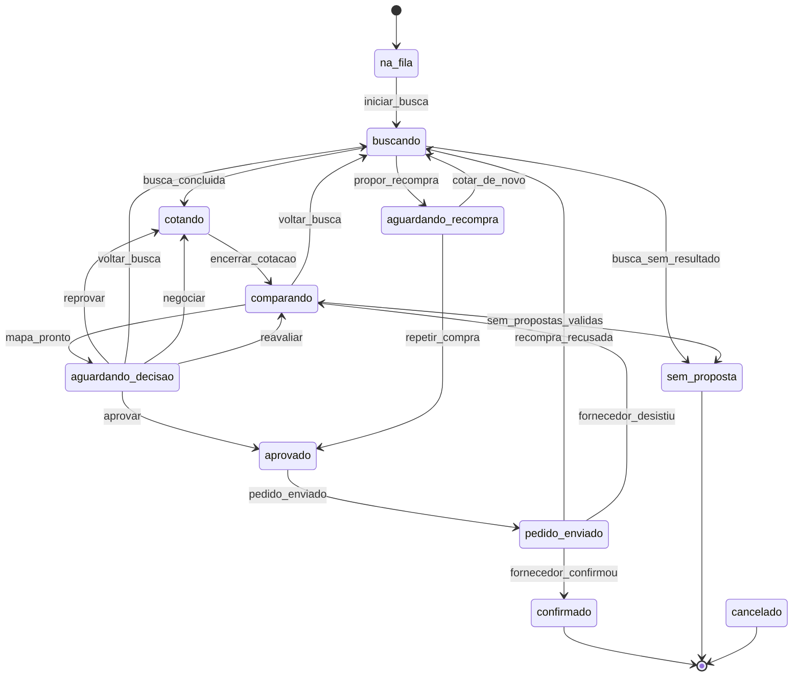

# Pitch e demonstração

Roteiro da apresentação (Q5) e explicação das escolhas (Q6). Para o funcionamento detalhado, veja [arquitetura.md](arquitetura.md).

## A mensagem em uma frase

O Kotala é um comprador de obra que trabalha sozinho do pedido à confirmação: entende o pedido mal escrito, busca preço real na internet, confere se o fornecedor é confiável, cota, negocia e monta o mapa de cotação. **A decisão de comprar é sempre de uma pessoa.**

## Roteiro (cerca de 6 minutos)

| Tempo | O que mostrar | Onde |
|---|---|---|
| 0:00 | O problema: cotar um material leva dias de mensagem, planilha e conferência. A estimativa da área de compras é de cerca de 7 dias por compra | Fala |
| 0:40 | O comprador manda um pedido mal escrito no Telegram: "preciso de 40 cp2 pra obra, obra parada, até quinta". O assistente lê o jargão, usa o endereço padrão da empresa e pergunta "Entendi assim, confirma?" | Celular (@KotalaAssit_bot) e quadro |
| 1:20 | A banca vira fornecedor: QR na tela, a pessoa entra no bot, diz o nome da empresa e recebe o pedido de cotação | Tela Convite e celular da banca |
| 1:50 | Busca real: preços da internet com link, hora e frete para o CEP; lojas encontradas com CNPJ conferido na Receita, nas listas de empresas punidas e no TJSP | Pedido → "Preço de referência na internet" e tela Fornecedores |
| 2:40 | Os fornecedores respondem do jeito deles (texto, áudio, PDF). Um pergunta antes de cotar, um esquece e recebe lembrete, um manda preço 40% abaixo e o sistema pede confirmação | Linha do tempo do pedido |
| 3:30 | Mapa de cotação: custo total com frete, cortes com motivo, nota com pesos, "obra parada" dobra o peso do prazo e o mais rápido ganha mesmo custando mais | Pedido → Mapa |
| 3:50 | Um fornecedor não respondeu: "Ligar por voz". O assistente conversa em tempo real, confirma os valores e a ligação vira proposta no mapa | Pedido → Ligar por voz (fone de ouvido; alguém do time faz o fornecedor) |
| 4:10 | Reprovar por preço alto: o assistente negocia sem revelar valor de outro fornecedor e o preço cai | Pedido → Reprovar → "Preço alto: negociar" |
| 4:50 | Aprovar em dois toques: pedido de compra ao vencedor, aviso aos outros, confirmação | Pedido → Aprovar → modal |
| 5:20 | Segunda compra do mesmo item: o sistema propõe repetir com o mesmo fornecedor (menos de 3 meses), com o histórico à vista | Chat ou Telegram |
| 5:40 | Quanto o assistente devolveu: economia contra a referência pública e na negociação, tempo e trabalho feito; e a linha do tempo mostrando cada decisão e cada chamada de IA | Telas Economia e Pedido |

## Antes de apresentar (checklist)

- [ ] `docker compose up -d --build` e as telas abrindo em http://127.0.0.1:3300 (usar o container ou `npm run telas`, nunca o modo dev).
- [ ] Os dois bots respondendo (`docker compose logs bots`).
- [ ] `PRAZO_RESPOSTAS_SEG` ajustado para o tempo do palco (120 s é confortável; 60 s se a demo estiver apertada).
- [ ] Rede: hotspot testado. Sem rede, `BUSCA_MODO=snapshot` usa as buscas já guardadas (a tela mostra a hora da coleta).
- [ ] Um pedido ensaiado do mesmo item antes, para a recompra aparecer.
- [ ] Celular com Telegram aberto no bot do comprador; QR do convite em outra aba.
- [ ] Créditos do Serper: conferir que sobra folga (`SERPER_LIMITE`).
- [ ] Voz: fone de ouvido, microfone liberado no navegador e um ensaio com `npm run voz:testar`.

## Plano B

| Se… | Então |
|---|---|
| A banca não ler o QR | Um celular do time responde como fornecedor; os simulados garantem volume |
| A internet cair | `BUSCA_MODO=snapshot`; o mapa e a negociação funcionam com os simulados |
| A IA der limite | A troca automática de modelo e de chave já está ligada; o registro mostra quando caiu na reserva |
| O TJSP estiver fora (estava em manutenção em 07 e 08/11) | A verificação diz "não consultado" e não tira ponto: é dado real |
| A voz falhar ao vivo | Mostrar a transcrição de um ensaio e o `npm run voz:testar`; o resto do fluxo não depende da voz |

## Perguntas prováveis da banca

| Pergunta | Resposta curta |
|---|---|
| Os fornecedores são de verdade? | Os preços da internet são reais, com link e hora. Os fornecedores que conversam são simulados e aparecem marcados; a banca pode entrar como fornecedor real pelo QR |
| A IA compra sozinha? | Não. Toda compra passa por dois toques do comprador; a IA não tem ferramenta de aprovar |
| E se o fornecedor tentar enganar o bot? | O texto do fornecedor é tratado como dado, nunca como instrução; testamos 13 casos de manipulação com a IA real (`npm run seguranca:testar`) |
| Como sabem que o fornecedor é confiável? | CNPJ na Receita, listas de empresas punidas (CEIS e CNEP) do Portal da Transparência, TJSP, site e histórico, com os motivos à vista |
| A negociação expõe o preço dos concorrentes? | Não: a contraproposta nunca cita valor de outro fornecedor, só a referência pública da internet |
| Dá para auditar? | Sim: cada mudança de dado fica gravada com o antes e o depois, junto com o motivo de cada agente e cada chamada de IA |
| Quanto custa rodar? | Nada além do crédito gratuito: Gemini, VTEX, BrasilAPI e Portal da Transparência sem custo; o Serper usa um crédito único com teto no app |
| Dados pessoais? | Só o necessário sai nas buscas; sócios, telefones e e-mails das fontes públicas são descartados antes de gravar |

## Por que foi feito assim (Q6)

| Escolha | Por quê |
|---|---|
| Máquina de estados própria, sem LangChain nem LangGraph | O fluxo é de eventos (mensagem chegou, prazo venceu, comprador aprovou). Cada passo é uma transição atômica no banco, com o motivo registrado; dá para auditar e não processa nada duas vezes |
| A IA só lê e escreve; contas e decisões em código | Custo total, cortes, notas e a recomendação são calculados em código; a IA só interpreta texto e redige a justificativa, e um valor que não está no mapa derruba o texto para um modelo pronto |
| Preço real com fonte, nunca inventado | Cada preço da internet tem link, hora, método e trecho conferido; o que não tem fonte não entra |
| Fornecedor simulado marcado | O volume da demo vem de simulados, sempre identificados; o preço deles segue a referência real |
| Verificação com fontes públicas | Confiança é critério do mapa; as fontes são públicas e gratuitas, e a fonte fora do ar não pune |
| Um canal só para todos os agentes | Telegram, chat web e e-mail viram a mesma mensagem; trocar de canal não muda os agentes, e o PARAR vale em todos |
| Rastreio completo | Auditoria no próprio Postgres: o estado de qualquer pedido em qualquer instante pode ser reconstruído |

## Os estados de um item

Gerado da tabela de transições do código (`diagramaMermaid()` em `src/nucleo/orquestrador/estados.ts`):

